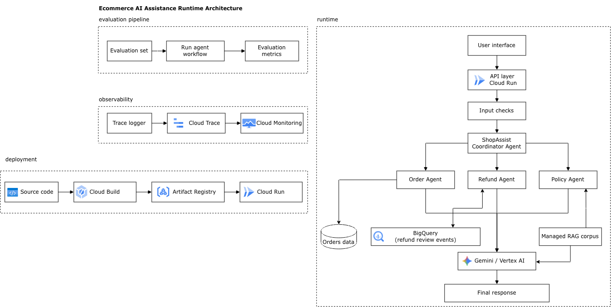

# ShopAssist

A personal project for an AI shopping-support assistant built with Google ADK and Gemini on Google Cloud. A coordinator delegates requests to three specialist agents:



- **Orders:** look up shipment and delivery details from synthetic order data.
- **Refunds:** validate customer ownership and refund eligibility, record requests, and route larger amounts for manager or finance review.
- **Policies:** retrieve return, refund, and shipping policies through RAG Engine.

Pending refund requests are logged to BigQuery when configured. The model is `gemini-2.5-flash-lite`. This project simulates refund workflows; it does not issue payments.

## Project layout

```text
app/                 Agents, tools, security callbacks, and refund review CLI
scripts/             RAG corpus creation and retrieval check
tests/unit/          Unit tests with mocked cloud calls
evals/               Versioned agent evaluation examples
Procfile             Cloud Run API server startup command
```

## Setup

Use Python 3.13 (the deployment version in `.python-version`), the Google Cloud CLI with `bq`, and a Google Cloud project with billing enabled. Run commands from the repository root. All project IDs and resource names below are placeholders or examples.

```bash
python3.13 -m venv .venv
source .venv/bin/activate
python -m pip install -r requirements.txt
python -m pip install pytest
test -f .env || cp .env.example .env
```

Edit your local `.env` with these values:

| Variable | Purpose |
| --- | --- |
| `GOOGLE_GENAI_USE_VERTEXAI` | Keep `TRUE` to use Google Cloud authentication. |
| `GOOGLE_CLOUD_PROJECT` | Your Google Cloud project ID. |
| `GOOGLE_CLOUD_LOCATION` | A region or endpoint supporting the configured Gemini model. |
| `RAG_LOCATION` | A supported RAG region enabled for your project. |
| `RAG_CORPUS_RESOURCE` | Full corpus resource name printed by the creation script below. |
| `BIGQUERY_REFUND_TABLE` | `your-gcp-project-id.shopassist.refund_reviews`; leave empty to skip audit writes. |

Check [RAG region availability](https://docs.cloud.google.com/gemini-enterprise-agent-platform/build/rag-engine/rag-overview) before selecting `RAG_LOCATION`; some regions require project allowlisting. The model and RAG regions can differ.

Authenticate and load your own local configuration:

```bash
set -a
source .env
set +a

gcloud auth login
gcloud auth application-default login
gcloud auth application-default set-quota-project "$GOOGLE_CLOUD_PROJECT"

gcloud services enable \
  run.googleapis.com \
  cloudbuild.googleapis.com \
  artifactregistry.googleapis.com \
  aiplatform.googleapis.com \
  bigquery.googleapis.com \
  iam.googleapis.com \
  --project="$GOOGLE_CLOUD_PROJECT"
```

The setup commands require permission to enable APIs, create resources, and grant IAM roles. Source deployment requires the deployer roles described in [Cloud Run source deployment](https://docs.cloud.google.com/run/docs/deploying-source-code), including permission to act as the build and runtime service accounts. Your local account also needs access to the model, RAG corpus, and BigQuery table for local use.

## Prepare cloud resources

Create the policy corpus once:

```bash
python scripts/create_rag_corpus.py
```

Copy the printed `RAG_CORPUS_RESOURCE` value into `.env`, then reload and verify retrieval. Rerunning the creation script creates another corpus.

```bash
set -a
source .env
set +a
python scripts/test_rag_retrieval.py
```

Create dedicated runtime and build identities once for a new setup:

```bash
RUNTIME_SERVICE_ACCOUNT="shopassist-runtime@${GOOGLE_CLOUD_PROJECT}.iam.gserviceaccount.com"
BUILD_SERVICE_ACCOUNT="shopassist-build@${GOOGLE_CLOUD_PROJECT}.iam.gserviceaccount.com"

gcloud iam service-accounts create shopassist-runtime \
  --display-name="ShopAssist runtime" --project="$GOOGLE_CLOUD_PROJECT"
gcloud iam service-accounts create shopassist-build \
  --display-name="ShopAssist source builds" --project="$GOOGLE_CLOUD_PROJECT"

gcloud projects add-iam-policy-binding "$GOOGLE_CLOUD_PROJECT" \
  --member="serviceAccount:${RUNTIME_SERVICE_ACCOUNT}" \
  --role="roles/aiplatform.user"
gcloud projects add-iam-policy-binding "$GOOGLE_CLOUD_PROJECT" \
  --member="serviceAccount:${BUILD_SERVICE_ACCOUNT}" \
  --role="roles/run.builder"
```

For BigQuery audit logging, create the following dataset and table once. Choose a dataset location and set `BIGQUERY_REFUND_TABLE` in `.env` to match. Skip this block if that variable is empty. The table fields match `app/callbacks/audit.py`.

```bash
BIGQUERY_LOCATION="your-bigquery-location"

bq --project_id="$GOOGLE_CLOUD_PROJECT" --location="$BIGQUERY_LOCATION" \
  mk --dataset "${GOOGLE_CLOUD_PROJECT}:shopassist"
bq --project_id="$GOOGLE_CLOUD_PROJECT" --location="$BIGQUERY_LOCATION" \
  mk --table "${GOOGLE_CLOUD_PROJECT}:shopassist.refund_reviews" \
  'event_id:STRING,requested_at:TIMESTAMP,order_id:STRING,customer_id:STRING,refund_reason:STRING,refund_amount:FLOAT,currency:STRING,approval_required:STRING,approval_status:STRING'
bq add-iam-policy-binding \
  --member="serviceAccount:${RUNTIME_SERVICE_ACCOUNT}" \
  --role="roles/bigquery.dataEditor" \
  "${GOOGLE_CLOUD_PROJECT}:shopassist.refund_reviews"
```

The runtime role is scoped to this table; see [BigQuery table access](https://docs.cloud.google.com/bigquery/docs/control-access-to-resources-iam).

## Run locally

```bash
python -m pytest -q tests/unit
adk web --host 127.0.0.1 --port 8000 .
```

Open `http://127.0.0.1:8000` and select `app` to ask policy questions. To use the API server instead:

```bash
adk api_server --host 127.0.0.1 --port 8000 .
```

Order and refund tools require `customer_id` in session state; setting only the API `user_id` is insufficient. For a synthetic demo session:

```bash
curl -X POST http://127.0.0.1:8000/apps/app/users/demo-user/sessions \
  -H 'Content-Type: application/json' \
  -d '{"sessionId":"demo-session","state":{"customer_id":"CUS-001"}}'
curl -X POST http://127.0.0.1:8000/run \
  -H 'Content-Type: application/json' \
  -d '{"appName":"app","userId":"demo-user","sessionId":"demo-session","newMessage":{"role":"user","parts":[{"text":"Where is ORD-101?"}]}}'
```

Simulate human approval for a pending refund using:

```bash
python -m app.refund_approval ORD-102 manager approved
```

This modifies local order data only; it does not update the BigQuery audit row or transfer money. Live model calls and RAG operations use your Google Cloud project. The unit tests mock cloud calls.

## Deploy to Cloud Run

After the setup above, choose your Cloud Run region and deploy from the repository root. The existing `Procfile` starts the ADK API server on `$PORT`, and `.python-version` selects Python 3.13 through the [Python buildpack](https://docs.cloud.google.com/docs/buildpacks/python).

```bash
set -a
source .env
set +a

RUN_REGION="your-cloud-run-region"
SERVICE_NAME="shopassist"
RUNTIME_SERVICE_ACCOUNT="shopassist-runtime@${GOOGLE_CLOUD_PROJECT}.iam.gserviceaccount.com"
BUILD_SERVICE_ACCOUNT="shopassist-build@${GOOGLE_CLOUD_PROJECT}.iam.gserviceaccount.com"

# Review the source files that will be uploaded before deploying.
gcloud meta list-files-for-upload

gcloud run deploy "$SERVICE_NAME" \
  --source . \
  --project="$GOOGLE_CLOUD_PROJECT" \
  --region="$RUN_REGION" \
  --service-account="$RUNTIME_SERVICE_ACCOUNT" \
  --build-service-account="projects/${GOOGLE_CLOUD_PROJECT}/serviceAccounts/${BUILD_SERVICE_ACCOUNT}" \
  --no-allow-unauthenticated \
  --min-instances=0 \
  --max-instances=1 \
  --concurrency=1 \
  --set-env-vars="GOOGLE_GENAI_USE_VERTEXAI=TRUE,GOOGLE_CLOUD_PROJECT=${GOOGLE_CLOUD_PROJECT},GOOGLE_CLOUD_LOCATION=${GOOGLE_CLOUD_LOCATION},RAG_LOCATION=${RAG_LOCATION},RAG_CORPUS_RESOURCE=${RAG_CORPUS_RESOURCE},BIGQUERY_REFUND_TABLE=${BIGQUERY_REFUND_TABLE}"

SERVICE_URL="$(gcloud run services describe "$SERVICE_NAME" \
  --project="$GOOGLE_CLOUD_PROJECT" --region="$RUN_REGION" \
  --format='value(status.url)')"
curl --fail-with-body \
  -H "Authorization: Bearer $(gcloud auth print-identity-token)" \
  "$SERVICE_URL/list-apps"
```